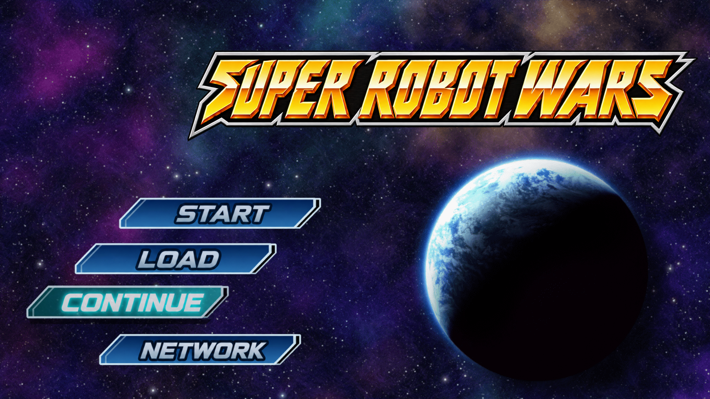
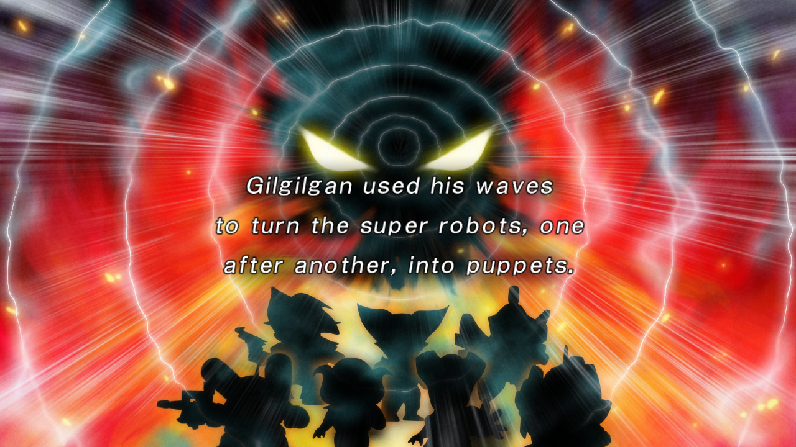
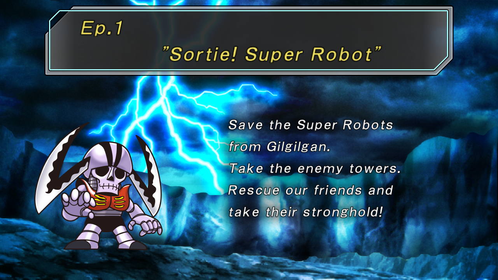

# Super Robot Wars HD — English Translation

An English fan translation of **Super Robot Taisen HD / Super Robot Wars HD**,
with playtest builds for **PS3 / RPCS3 (NPJB00514)** and **Vita / Vita3K
(PCSG00260)**.

**Playtesting is open on both platforms.** Ask about build availability
and share feedback on [Discord](https://discord.gg/DwR2jxj5b).

| Platform | Current preview | Playtest package |
|---|---|---|
| PS3 — NPJB00514 | **0.1.9-preview** | Windows RPCS3 patcher; `SRWT1-HD-English-0.1.9-preview.zip` |
| Vita — PCSG00260 | **0.1.10-vita-preview** | Replacement files in a `rePatch/PCSG00260` folder; `SRW-HD-Vita-PCSG00260-English-0.1.10-vita-preview-rePatch.zip` |

The Vita build has automated text, spacing, paging, archive, and packaging
checks. The current Vita layout and dialogue fixes still need in-game
confirmation. The Vita package uses the rePatch layout for hardware testing,
and hardware compatibility still needs verification.

## What's been done

The PS3 translation includes **6,898 validated entries**, English story and
battle dialogue, menus, descriptions, and unit information. It also includes:

- A single-line **Super Robot Wars** logo and faithful English title-menu artwork.
- Measured proportional spacing, episode-title corrections, and menu overlap fixes.
- English **Objectives**, **Battle Report**, and **Level Up!** graphics.
- Pixel-aware battle wrapping and second pages, including PS3 multi-unit attacks.
- A Windows patcher with file checks, backups, upgrades, and restoration.

The Vita port reuses the translation and artwork, with **6,710 translated string
occurrences**, including 203 relocated to fit the English text. It adds:

- Native ARM spacing hooks matching the PS3's 95 measured ASCII glyphs, including tighter `k` and `s`.
- Two-page attack/counter dialogue support and native fast-forward timing.
- Reviewed Vita save-data messages, terrain names, and ambiguous shared labels.
- Allies/Enemies spacing and the team-selection banner correction.
- Faithful **Select Hero**, **Select Team**, **Select Units**, and **Bonus Allocation** headings.
- English Attack/Counter battle banners and corrected Objectives placement.
- Compact bonus confirmation rows preserving all six stat values, plus a corrected map-save prompt.
- Native Vita GXT artwork conversion, build verification, checked Vita3K installation, and rePatch packaging tools.

Both title screens include a small, inset two-line `pk87` / `eng vNUMBER`
label. The number is baked from the build version.

### November 20, 2026 playtest update

- **Both platforms:** Shorter terrain names, a one-line early End Phase
  warning, an English **Battle Report** banner, and a repaired **Level Up!**
  graphic.
- **Vita:** English prebattle deployment instructions and button hints,
  shorter choices within Quick Command, a dedicated **P** column for
  weapons usable after moving, and single percent signs on map modifiers.
  Battle and persuasion dialogue now pass each row separately to the
  renderer to address repeated and cut-off text.

Earlier previews also improved the spacing for **Evade** and **Recover**,
translated the terrain next to **MAP**, and fixed the Upgrade Item
placeholder and team selection prompt.

## Screenshots

### Translated prelude

### Episode title and mission briefing

All screenshots shown here are **PS3 / RPCS3 captures**. The title image is the
latest approved title-menu capture from November 4, 2026, showing the faithful
English selections. [Capture details](docs/screenshots/README.md) record their
dates. Vita screenshots will be added after clean in-game captures are verified.

## Join the test

### PS3 / RPCS3

1. Install your own Japanese **NPJB00514** game and confirm it boots in RPCS3.
2. Get the PS3 test build through [Discord](https://discord.gg/DwR2jxj5b).
3. Close RPCS3, extract the complete patcher package, and run **SRW English Patcher.exe**.
4. Select RPCS3 and the installed game folder, then install the English patch.

Keep the patcher's backups for restoration and upgrades. PS3 players do not
need Python. See the [PS3 installation guide](docs/TOOLS.md#player-installation).

### Vita / PCSG00260

Use the **Vita rePatch ZIP** for this platform. It contains a standard
`rePatch/PCSG00260` tree, installation instructions, and checksums.

- **Vita hardware:** follow the [Vita playtest guide](docs/VITA_INSTALL.md) to place the overlay under `ux0:rePatch/PCSG00260` with a working rePatch plugin.
- **Vita3K:** back up the two original files, then copy the contents of `rePatch/PCSG00260` into the installed `ux0/app/PCSG00260` folder. The guide also covers optional checked installation with Python.

Please test deployment, Quick Command, weapon lists, and early End Phase
on Vita. Please also check long attack and persuasion quotes, multi-unit
attacks, page transitions, fast-forward, and the return to the map.
Include the **platform, title ID, build version, emulator version or Vita
firmware, episode, unit/attack or menu, and reproduction steps**. Screenshots
help with missing, cut-off, or overlapping text.

Feedback is welcome on [Discord](https://discord.gg/DwR2jxj5b) or through
[GitHub Issues](https://github.com/mlastes1987/SRTHD-En/issues/new?template=bug_report.yml).

## What's in this repository

| Location | Contents |
|---|---|
| [`tools/`](tools) | PS3 and Vita text, spacing, paging, archive/texture, validation, installation, and packaging tools |
| [`installer/`](installer) | PS3 Windows patcher source and integration-test harness |
| [`docs/`](docs) | Tool instructions, development notes, platform guides, and screenshots |

This is a **source/tools repository**. Game files, patched executables and
archives, release ZIPs, license keys, saves, and emulators are excluded from Git.
Vita glyph measurements and reviewed source-text overrides are included; full
working translation tables and approved artwork remain maintainer-local inputs.
A clean clone is not a complete translation build workspace.

Start with the [tool usage guide](docs/TOOLS.md), [development setup](docs/DEVELOPMENT.md),
[Vita developer guide](docs/VITA_PORT.md), [Vita player guide](docs/VITA_INSTALL.md),
or [PS3 release pipeline](docs/PATCHING_PIPELINE.md). The
[detailed changelog](CHANGELOG.md) records changes and remaining test coverage.

## Platform and license

Supported development targets are Japanese **PS3 NPJB00514** and **Vita
PCSG00260 v1.00**. Other regions and revisions have not been verified. The
PS3 installer is an unsigned Windows preview; the Vita rePatch ZIP is an
experimental playtest package.

Project code is distributed under the existing [MIT license](LICENSE). Game
artwork and screenshots belong to their respective rights holders and are not
covered by the code license. This is an unofficial fan project, unaffiliated
with the original developers or publishers.
