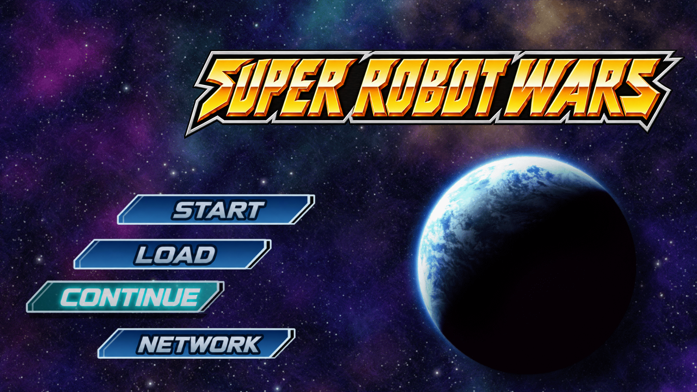
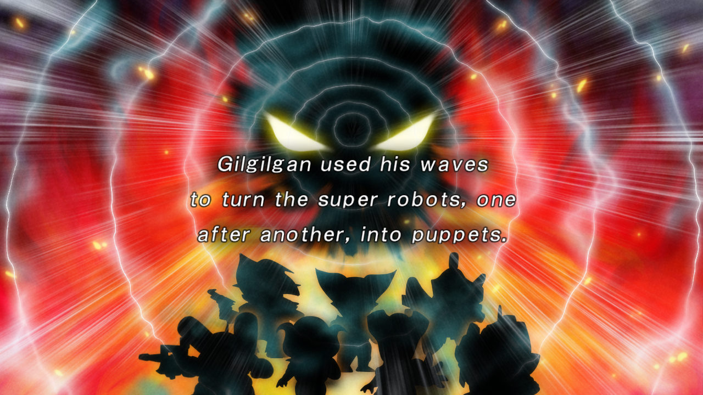
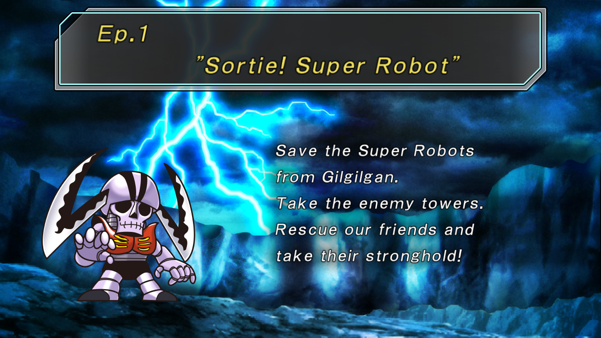

# Super Robot Wars HD — English Translation

An English fan translation of **Super Robot Taisen HD / Super Robot Wars HD** for PlayStation 3, currently being tested in **RPCS3** with the Japanese **NPJB00514** release.

**We're open for testing! Get the current test build and share feedback on [our Discord server](https://discord.gg/DwR2jxj5b).**

Current preview: **0.1.1-preview**. Recent changes include multi-unit battle paging and a correction for the shared suffix in the team-selection banner. Please help check these in-game.

## What's been done

- English story text, battle quotes, menus, descriptions, and unit information, with **6,898 translated entries** checked by the build validator.
- A single-line **Super Robot Wars** logo and English title-menu graphics styled after the original artwork.
- Proportional glyph spacing and fixes for missing text, episode titles, and overlapping menu labels.
- English **Objectives** and **Level Up!** graphics.
- Pixel-based battle-dialogue wrapping and automatic second pages for longer quotes, including multi-unit attacks.
- A Windows RPCS3 patcher with file checks, original backups, upgrades, and restoration.

This is a **work-in-progress test build**, not a finished release. Text polish, menu layouts, and battle paging need more playtesting. Passing build checks does not mean every scene has been verified in-game.

## Screenshots

### Translated prelude

### Episode title and mission briefing

The title screenshot above is the latest title-menu capture from November 4, 2026, showing the faithful English selections. These are real RPCS3 captures; [capture details](docs/screenshots/README.md) include their dates.

## Join the test

1. Install your own copy of **NPJB00514** in RPCS3 and confirm the unpatched game boots.
2. Join [Discord](https://discord.gg/DwR2jxj5b) for the **current test build** and its installation instructions.
3. Close RPCS3, extract the patcher package, and run **SRW English Patcher.exe** on Windows.
4. Select your RPCS3 executable and installed game folder, then install the patch.

Keep the patcher's original backups if you want to restore the game or install future updates. Players do **not** need Python to use the Windows patcher.

We especially welcome reports of:

- Missing, cut-off, or overlapping text and untranslated graphics.
- Battle quotes that do not show both pages, including multi-unit attacks.
- Awkward wording, inconsistent names, or unclear descriptions.
- Installer problems, crashes, or progression issues.

Please include the test-build version, RPCS3 version, episode, unit/attack or menu involved, what you expected, and a screenshot if possible. Feedback is welcome on Discord or through [GitHub Issues](https://github.com/mlastes1987/SRTHD-En/issues/new?template=bug_report.yml).

## What's in this repository

| Folder | Contents |
|---|---|
| [`tools/`](tools) | Text extraction/import, validation, font spacing, battle paging, archive/texture tools, and release packaging |
| [`installer/`](installer) | Windows patcher source and integration-test harness |
| [`docs/`](docs) | Developer setup, patching notes, and screenshots |

This repository contains **tools, source, documentation, and screenshots**. It does not include the game, complete patched executables or archives, license keys, saves, or a bundled emulator. **Current test builds are available through [Discord](https://discord.gg/DwR2jxj5b).**

Start with the [tool usage guide](docs/TOOLS.md) for step-by-step commands, the [development guide](docs/DEVELOPMENT.md) for local setup, and the [release pipeline](docs/PATCHING_PIPELINE.md) for packaging. The [detailed changelog](CHANGELOG.md) records preview changes, earlier fixes, and remaining test coverage. The working translation tables, extracted assets, and finished artwork archives are maintainer-local inputs; a clean clone is a tools checkout, not a complete translation build workspace.

## Platform and license

Current testing focuses on **PS3 NPJB00514 in RPCS3**. The Windows installer is a preview and is unsigned. Other regions, game revisions, and platforms have not been verified; there is no Vita test build in this repository.

Project code is distributed under the existing [MIT license](LICENSE). Game artwork and screenshots depict material owned by its respective rights holders and are not covered by that code license. This is an unofficial fan project, unaffiliated with the original developers or publishers.
